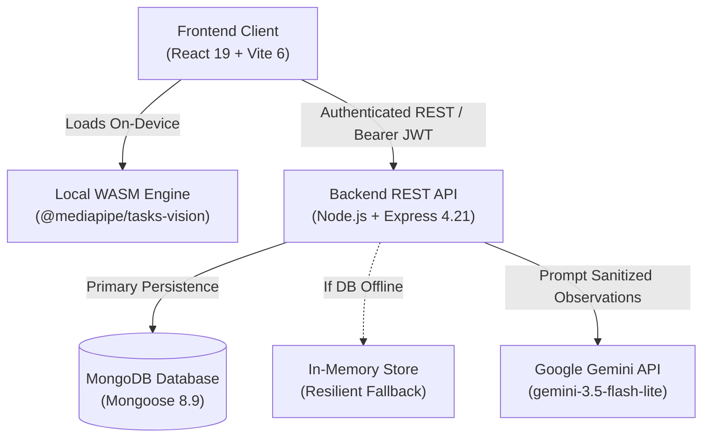

# 01 — Project Overview

## 1. Executive Summary

**NeuroGuard AI** is an intelligent, full-stack home recovery and longitudinal rehabilitation monitoring platform. Developed specifically for stroke survivors, neurological patients, and their clinical care teams, the platform bridges the critical visibility gap between hospital discharge and outpatient clinical follow-ups.

By leveraging client-side Computer Vision (via Google MediaPipe Tasks Vision WebAssembly) and high-performance pose landmark extraction directly in the browser, NeuroGuard AI delivers objective, quantitative kinematic assessment without compromising patient privacy or transmitting sensitive video feeds across the internet.

```
       +-------------------------------------------------------------+
       |                     NeuroGuard AI                           |
       |     AI-Assisted Home Recovery & Monitoring Platform         |
       +-------------------------------------------------------------+
                                      |
         +----------------------------+----------------------------+
         |                                                         |
         v                                                         v
+------------------+                                     +-------------------+
|   PATIENT &      |                                     |  DOCTOR / CLINIC  |
|   CAREGIVER      |                                     |    OVERSIGHT      |
+------------------+                                     +-------------------+
| • MediaPipe CV   |                                     | • Triage Roster   |
| • 3 Exercises    |                                     | • Protocol Prescr.|
| • Personal Trend |                                     | • Session Review  |
| • In-Person Appt |                                     | • Schedule & Slots|
| • Report Consent |                                     | • Audited Reports |
+------------------+                                     +-------------------+
```

---

## 2. Core Missions and Objectives

The NeuroGuard AI platform is guided by five primary objectives:

1. **Objective Quantitative Tele-Kinematics:** Replace subjective paper diaries and retrospective patient recollection with millisecond-accurate mathematical metrics, tracking joint elevation angles, trunk stability, movement symmetry, and path efficiency.
2. **Personal Baseline Reference Architecture:** Stroke deficits and recovery rates vary greatly across individuals. The system compares a patient’s current performance against their own recent 5-session moving-window baseline rather than misleading population-wide averages.
3. **Zero-Video Data Minimization:** Safeguard vulnerable patient privacy by performing 100% of body tracking and landmark extraction on-device. The backend receives only structured numerical coordinate arrays and aggregate assessment metrics.
4. **Closed-Loop Clinical Collaboration:** Enable physical therapists and neurologists to assign tailored protocols, monitor compliance, review exercise execution with clinician notes, and schedule in-person clinic visits.
5. **Empathetic, Guardrailed AI Synthesis:** Provide patients with comprehensible, non-jargon explanations generated via the Google Gemini API, backed by rigorous server-side prompt sanitization and deterministic local fallbacks.

---

## 3. Technology Stack Breakdown

The codebase is structured as an enterprise-grade decoupled monorepo comprising a React Single Page Application (SPA) and an Express.js REST API service:



### Frontend Technology Stack
- **Library / Runtime:** React 19.0.0
- **Build Tool / Bundler:** Vite 6.0.5 with `@vitejs/plugin-react` 4.3.4
- **Computer Vision:** `@mediapipe/tasks-vision` 0.10.22 running local WebAssembly (`/mediapipe/wasm/vision_wasm_internal.wasm`) and model assets (`/models/pose_landmarker_lite.task`)
- **Data Visualizations:** Recharts 2.15.0 (SVG LineCharts, XAxis, YAxis, Tooltips, Custom Legend, ResponsiveContainers)
- **Iconography:** Lucide React 0.468.0
- **Styling Architecture:** Pure modular Vanilla CSS (`frontend/src/styles/app.css`) with CSS custom properties (design tokens for typography, surfaces, elevations, and responsive breakpoints).

### Backend Technology Stack
- **Runtime Environment:** Node.js v20.x+ (utilizing native ECMAScript modules and native `fetch` with `AbortController`)
- **Web Framework:** Express 4.21.2
- **Database Object Modeling:** Mongoose 8.9.5 connecting to MongoDB (with zero-configuration automatic fallback to in-memory store in [store.js](file:///home/piyush/Team Matrix/Hacksprint/backend/src/store.js))
- **Security & Hardening:**
  - `helmet` 8.3.0 for HTTP header hardening
  - `cors` 2.8.5 for origin validation
  - `bcryptjs` 3.0.3 for password hashing with salt rounds of 10
  - `jsonwebtoken` 9.0.3 for cryptographically signed authentication tokens
- **AI Integration:** Google Gemini REST API (`https://generativelanguage.googleapis.com/v1beta/models/gemini-3.5-flash-lite:generateContent`) with native fetch, timeout abort signals, and server-side metric whitelisting.

---

## 4. Key Architectural Highlights

- **Dual-Storage Resilience Architecture:** The backend features a resilient data layer. If `MONGODB_URI` is provided, all entities (Users, Doctors, Appointments, Reports, Notifications, Assignments, Assessments) are stored in MongoDB. If MongoDB is unavailable or unconfigured, the application runs without disruption using memory maps and seed arrays in [store.js](file:///home/piyush/Team Matrix/Hacksprint/backend/src/store.js).
- **GPU-to-CPU Fallback Pipeline:** In [pose.js](file:///home/piyush/Team Matrix/Hacksprint/frontend/src/lib/pose.js), MediaPipe initialization attempts hardware-accelerated WebGL GPU delegation first. If the host machine lacks WebGL 2.0 or throws a shader compilation error, it falls back to a CPU delegate.
- **Atomic Concurrency Protection:** Appointment booking implements double-booking prevention utilizing both an in-memory active lock mutex (`activeBookingLocks = new Set()`) and a MongoDB partial unique index on `{ doctorId: 1, date: 1, startTime: 1 }` filtered on active statuses.
- **Audit-Logged Data Sharing:** Patient reports are not exposed publicly. Access requires explicit patient consent, can be revoked at any time, and logs every view event (timestamp, doctor ID, IP, user agent) in an immutable access audit trail.

---

## 5. Repository Structure Overview

```
.
├── backend/                        # Node.js + Express API Service
│   ├── src/
│   │   ├── middleware/             # Auth JWT, Role checks, Rate Limiters
│   │   ├── models/                 # Mongoose schemas (Doctor, Appointment, etc.)
│   │   ├── routes/                 # Express route handlers
│   │   ├── services/               # Core business logic (Gemini, Booking, Reports)
│   │   ├── db.js                   # Mongoose connection manager & health checks
│   │   ├── server.js               # Application entry point & route mounting
│   │   ├── store.js                # In-memory database store & seed data
│   │   └── trendEngine.js          # Longitudinal statistics & baseline engine
│   ├── test/                       # 96 comprehensive automated tests (Node --test)
│   ├── package.json
│   └── .env.example
├── frontend/                       # React 19 + Vite SPA Client
│   ├── public/                     # Static assets (MediaPipe WASM & TFLite Model)
│   │   ├── mediapipe/wasm/         # Local WASM binaries
│   │   └── models/                 # pose_landmarker_lite.task
│   ├── src/
│   │   ├── components/             # Reusable UI & Modals (Booking, Report, Camera)
│   │   ├── lib/                    # API client, Pose tracking, Kinematic scoring
│   │   ├── pages/                  # Page views (Dashboard, Doctor, Appointments)
│   │   ├── styles/                 # Global styles and design tokens
│   │   ├── App.jsx                 # Top-level state and routing shell
│   │   └── main.jsx                # DOM mounting entry point
│   ├── package.json
│   └── vite.config.js
└── docs/                           # Technical documentation & developer knowledge base
```
