# 03 — Product Vision

## 1. Long-Term Vision and North Star

The North Star of **NeuroGuard AI** is to make high-quality, continuous neurological recovery monitoring accessible to every patient, anywhere in the world, without requiring specialized sensor hardware, wearable gyroscopes, or high-bandwidth video streaming.

By turning any standard smartphone, tablet, or laptop webcam into an intelligent kinematic measurement instrument, NeuroGuard democratizes neurorehabilitation data and creates a seamless continuum of care between the patient's home and the clinician's examination room.

```
+---------------------------------------------------------------------------------------+
|                               THE CONTINUUM OF CARE                                   |
+---------------------------------------------------------------------------------------+
|   HOME ENVIRONMENT                      CLINIC ENVIRONMENT                            |
|   • Daily 2-minute functional checks    • Outpatient in-person review                 |
|   • Local edge computer vision          • Objective kinematic charts                  |
|   • Personal baseline calculation       • Protocol adjustments & assignments          |
|   • Empathetic AI guidance              • Physical diagnostic & manual interventions  |
+---------------------------------------------------------------------------------------+
```

---

## 2. Core Product Principles

### Principle 1: Assistive, Not Diagnostic
NeuroGuard AI is explicitly designed as a **monitoring and documentation tool**, not an autonomous diagnostic system. The platform measures physical parameters (degrees of joint angle, symmetry ratios, movement smoothness, repetition completion) and documents historical trends. It never claims to diagnose recurrent stroke, transient ischemic attacks (TIAs), neurological disorders, or medical emergencies.

### Principle 2: Clinician in the Loop
Technology should empower and inform healthcare professionals, not attempt to replace them. Doctors remain the sole authority for evaluating recovery, diagnosing pathology, setting clinical goals, and prescribing clinical protocols. NeuroGuard provides doctors with structured, high-signal data so their face-to-face consultation time is used effectively.

### Principle 3: Absolute Edge Privacy
A patient’s home is their sanctuary. To earn patient trust, NeuroGuard enforces an uncompromising data privacy architecture: raw camera frames never leave the client's RAM. They are rendered to an HTML5 canvas, evaluated by local WebAssembly binaries, and instantly discarded. Only numerical features (scores and timestamps) cross the network boundary.

### Principle 4: Radical Explainability
Black-box AI models that output ungrounded numbers or hallucinatory advice are dangerous in healthcare. Every score in NeuroGuard is derived from deterministic formulas (e.g., Euclidean distance between wrist and shoulder, joint angle cosine rules). When Gemini LLM explanations are provided, they are strictly constrained by structured observation objects and forbidden from inventing unmeasured metrics.

### Principle 5: Real-World In-Person Continuity
NeuroGuard rejects the premise that all healthcare can or should be replaced by remote video calls. Stroke rehabilitation frequently requires physical palpation, spasticity grading (Ashworth scale), manual resistance testing, and gait analysis. Therefore, the appointment module is built exclusively for **in-person clinical visits**, anchoring digital recovery back to real-world medical care.

---

## 3. Product Roadmap & Phased Evolution

```mermaid
flowchart LR
    subgraph P1 ["Phase 1: Current Prototype"]
        direction TB
        P1A["Browser MediaPipe WASM Edge AI"]
        P1B["Arm Raise, Sit-to-Stand, Seated Reach"]
        P1C["Moving-Window Personal Baseline Engine"]
        P1D["In-Person Appointment Booking & Mutex"]
        P1E["Patient-Authorized Recovery Reports"]
    end

    subgraph P2 ["Phase 2: Near-Term Expansion"]
        direction TB
        P2A["Hand Landmarker (Finger Tapping)"]
        P2B["Web Audio Phonation & Dysarthria Tracking"]
        P2C["Multi-Doctor Clinic Group Practices"]
        P2D["WebPush & SMS Clinical Alerts"]
    end

    subgraph P3 ["Phase 3: Clinical Validation"]
        direction TB
        P3A["IRB-Approved Clinical Trials"]
        P3B["Hospital EHR Integration (HL7 / FHIR)"]
        P3C["Automated Camera Distortion Calibration"]
        P3D["SaMD Regulatory Compliance Pathways"]
    end

    P1 --> P2 --> P3
```



---

## 4. Ethical Boundaries and Medical Disclaimers

To maintain compliance with healthcare software guidelines and agent instructions:

1. **Non-Diagnostic Notice:** Displayed prominently across the patient dashboard, assessment completion modals, and recovery report exports:
   > *"NeuroGuard AI provides assistive functional monitoring and recovery metric extraction. This report is supplementary clinical documentation and does not constitute a diagnostic evaluation or replacement for professional clinical judgment."*
2. **Emergency Protocol Disclaimer:** NeuroGuard is not an emergency monitoring service. Patients experiencing acute neurological warning signs (such as facial drooping, arm weakness, speech difficulty, or sudden severe headache) are explicitly instructed to contact emergency medical services (such as 108/112 in India or 911 in the US) immediately.
3. **Evidence Source Requirement:** Any future clinical threshold additions must be validated against established clinical scales (such as the Fugl-Meyer Assessment of Motor Recovery, the Berg Balance Scale, or the Action Research Arm Test) and reviewed by qualified clinical partners before being deployed in production.
