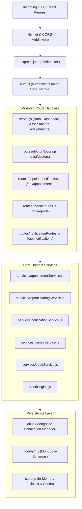

# Backend Architecture

## 1. Node.js & Express REST Service Overview

The **NeuroGuard AI Backend** is a modular RESTful microservice built with Node.js and Express 4.21. It serves as the secure orchestration layer between client browser applications, persistent MongoDB storage, local in-memory fallback stores, and external AI foundation models.

The backend is engineered for high reliability, strict healthcare data boundaries, and atomic transaction safety.



---

## 2. Directory Structure and Architectural Modules

```
backend/
├── src/
│   ├── middleware/
│   │   ├── auth.js                 # JWT token generation, verification, and RBAC
│   │   └── rateLimiter.js          # In-memory sliding window rate limiter
│   ├── models/                     # Mongoose Schemas & MongoDB Model Definitions
│   │   ├── Alert.js                # Anomaly alerts
│   │   ├── Appointment.js          # In-person clinic appointments with unique index
│   │   ├── Assessment.js           # Recorded kinematic assessment sessions
│   │   ├── Assignment.js           # Clinician exercise protocols
│   │   ├── Doctor.js               # Clinical profile, clinic address, fee, rating
│   │   ├── DoctorAvailability.js   # Working hours, slot durations, blocked slots
│   │   ├── Notification.js         # In-app user notifications
│   │   ├── SharedRecoveryReport.js # Authorized reports with access audit trail
│   │   └── User.js                 # Unified user accounts across all roles
│   ├── routes/                     # Specialized Express Sub-routers
│   │   ├── appointmentRoutes.js    # /api/appointments
│   │   ├── doctorRoutes.js         # /api/doctors
│   │   ├── notificationRoutes.js   # /api/notifications
│   │   └── reportRoutes.js         # /api/reports
│   ├── services/                   # Business Logic & Integration Services
│   │   ├── appointmentService.js   # Slot generation, mutex locks, status transitions
│   │   ├── geminiService.js        # Google Gemini API caller & prompt sanitization
│   │   ├── notificationService.js  # Async notification dispatch and read toggles
│   │   ├── reportSharingService.js # Report preview, consent sharing, revocation
│   │   └── seedService.js          # Database sync & auto-provisioning of doctors
│   ├── db.js                       # Mongoose connection management & health checks
│   ├── server.js                   # Application bootstrap, core routes, error handling
│   ├── store.js                    # In-memory database store & seed data
│   └── trendEngine.js              # Deterministic baseline, delta, and alert engine
├── test/                           # 96 Node.js native unit & integration tests
├── .env.example
└── package.json
```

---

## 3. Middleware Architecture & Pipeline

Requests passing through `backend/src/server.js` execute through a strict, ordered pipeline:

1. **Environment Initialization:** `require('dotenv').config()` loads local secrets from `.env`.
2. **Security Headers (`helmet`):**
   ```javascript
   app.use(helmet({
     crossOriginResourcePolicy: { policy: 'cross-origin' },
     contentSecurityPolicy: false,
   }));
   ```
   Ensures browser clients can download and execute local WebAssembly binaries without being blocked by restrictive CSP script-src directives.
3. **CORS Validation:** `cors({ origin: true })` allows cross-origin requests from the Vite development server (port 5173).
4. **Body Size Limiting:** `express.json({ limit: '256kb' })` prevents memory exhaustion and denial-of-service via oversized JSON payloads.
5. **JWT Authentication (`authenticateToken` in [auth.js](https://github.com/Raj-shukla-05/NeuroGuard-AI/blob/main/backend/src/middleware/auth.js#L13-L27)):**
   - Parses the `Authorization: Bearer <TOKEN>` header.
   - Verifies the cryptographic signature using `JWT_SECRET`.
   - Attaches decoded `{ userId, role, name, email }` to `req.user`.
   - Returns HTTP 401 Unauthorized for missing or malformed tokens.
6. **Role-Based Authorization (`requireRole`):**
   - Higher-order middleware factory: `requireRole('doctor')` or `requireRole('patient')`.
   - Enforces that only callers with appropriate claims in their JWT can access protected sub-trees.
   - Returns HTTP 403 Forbidden on role mismatch.
7. **Resource-Level Authorization (`requireSelfOrDoctor`):**
   - Prevents horizontal privilege escalation (IDOR).
   - Ensures patients can only access their own records (`req.params.id === req.user.userId`).
   - Ensures doctors can only access patients assigned to them (`patient.doctorId === req.user.userId`).

---

## 4. Routing Architecture & Sub-Routers

The main Express application mounts five modular sub-routers in [server.js](https://github.com/Raj-shukla-05/NeuroGuard-AI/blob/main/backend/src/server.js#L811-L817):

```javascript
app.use('/api/doctors', doctorRoutes);
app.use('/api/appointments', appointmentRoutes);
app.use('/api/reports', reportRoutes);
app.use('/api/notifications', notificationRoutes);
```

In addition, core endpoints are declared directly in `server.js`:
- `/api/health`: Database connection status and active AI model reporting.
- `/api/auth/login` and `/api/auth/signup`: Account creation, password hashing, and token issuance.
- `/api/users/:id/dashboard`, `/trends`, `/alerts`: Longitudinal patient progress data.
- `/api/assessments`: Ingestion of kinematic assessment results.
- `/api/assignments`: Clinician protocol prescription and lifecycle transitions.
- `/api/explanation`: Gemini AI explanation endpoint with server-side finding sanitization.
- `/api/speech/analyze`: Audio transcription similarity and speech rate analysis.
- `/api/users/:id/demo-decline`: Evaluation simulation scenario injection.

---

## 5. Error Handling & Graceful Degradation

The backend adheres to a standardized JSON error response schema:

```json
{
  "message": "Human-readable description of error"
}
```

- **400 Bad Request:** Malformed payload, invalid target repetition count, past appointment date.
- **401 Unauthorized:** Missing or invalid Bearer token.
- **403 Forbidden:** Accessing another patient's data, invalid role privilege.
- **404 Not Found:** Doctor, appointment, assignment, or report not found.
- **409 Conflict:** Double-booking collision, slot mutex acquisition failure.
- **429 Too Many Requests:** Rate limit exceeded.
- **500 Internal Server Error:** Unhandled operational failure.
