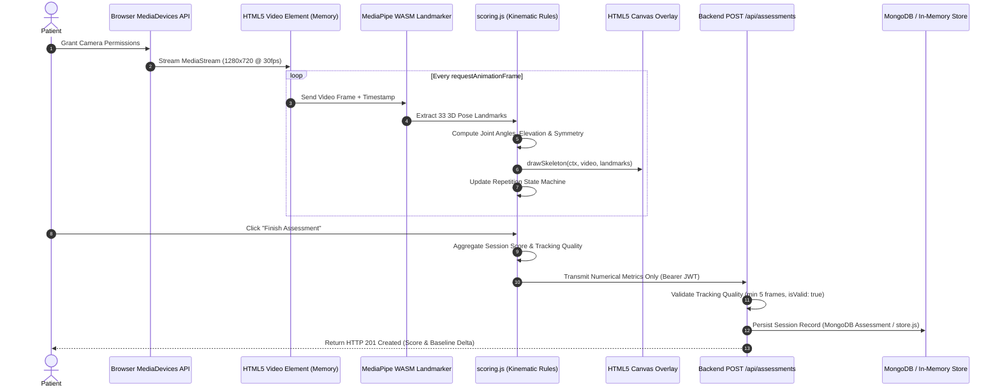
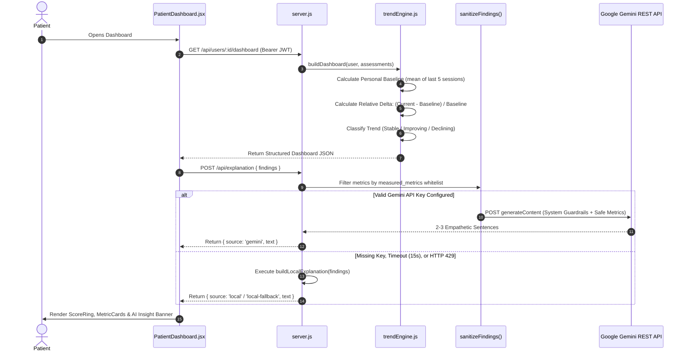
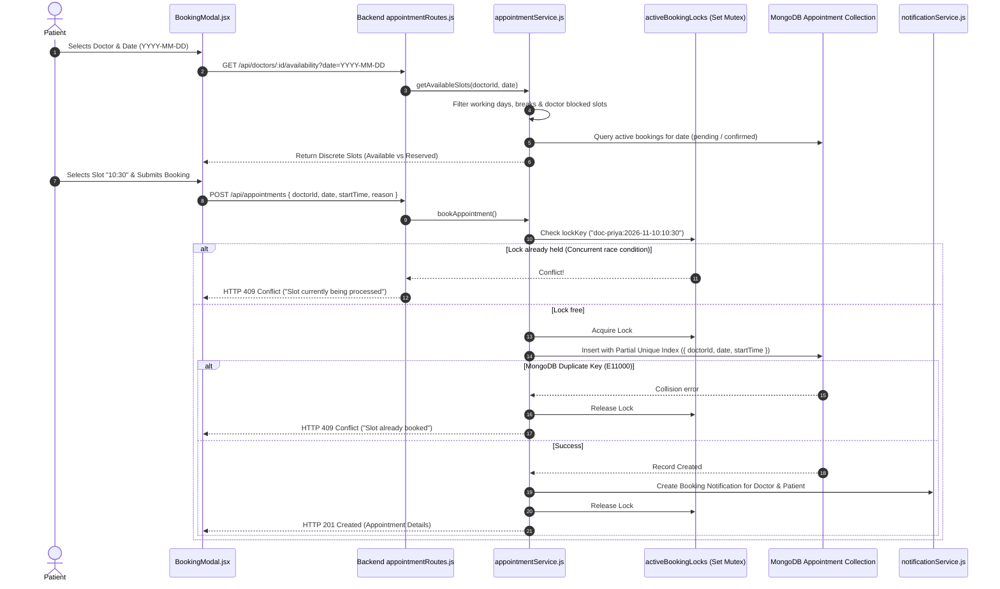
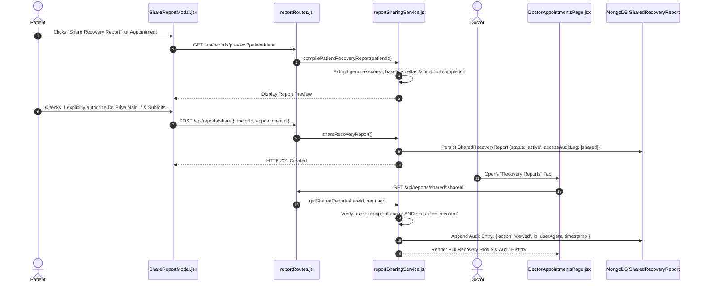

# Data Flow Architecture

This document maps how data moves through the NeuroGuard AI platform across four core operational flows:
1. **Camera Frame Kinematics & Scoring Flow**
2. **Longitudinal Trend & AI Insight Flow**
3. **Appointment Scheduling & Concurrency Flow**
4. **Report Sharing & Access Audit Flow**

---

## 1. Camera Frame Kinematics & Scoring Pipeline

The computer vision pipeline processes video frames on the patient's device without transmitting raw video over the network:

---

## 2. Longitudinal Trend & AI Explanation Flow

How repeated sessions are aggregated into baseline comparisons and non-diagnostic explanations:

---

## 3. In-Person Appointment Scheduling & Concurrency Flow

How appointment slots are generated and protected against double-booking:

---

## 4. Recovery Report Sharing & Access Audit Flow

How patient recovery documentation is compiled, authorized, and audited:

