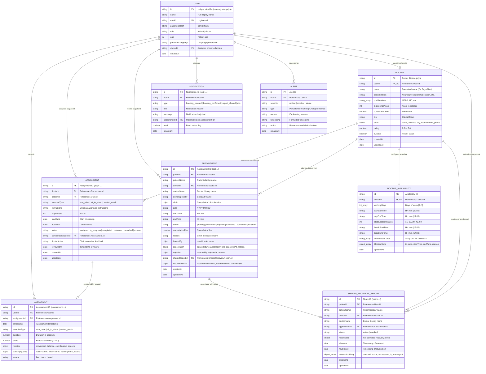

# Entity-Relationship (ER) Diagram

This document presents the complete Entity-Relationship schema for NeuroGuard AI, detailing cross-collection references, relational keys, cardinality, and field-level constraints across both MongoDB and the in-memory fallback store.

---

## 1. Complete Entity-Relationship Diagram



---

## 2. Relational Cardinality & Integrity Rules

| Relationship | Cardinality | Cascade & Delete Behavior | Enforcement Mechanism |
| :--- | :--- | :--- | :--- |
| **User $\rightarrow$ Assessment** | $1 : N$ | Deleting a patient retains historical assessment provenance. | Soft deletion / Inactive flag in enterprise tier. |
| **Doctor $\rightarrow$ DoctorAvailability** | $1 : 1$ | Deleting a doctor record cascades to delete their schedule configuration. | Managed in `seedService.js` and `Doctor.remove()`. |
| **Doctor $\rightarrow$ Appointment** | $1 : N$ | Doctors cannot be deleted if active pending or confirmed appointments exist. | Application middleware checks before profile deactivation. |
| **Patient $\rightarrow$ Assignment** | $1 : N$ | Deleting an assignment preserves completed session records in `Assessment`. | `completedSessionId` remains linked to `Assessment.id`. |
| **Appointment $\leftrightarrow$ SharedRecoveryReport** | $1 : 0..1$ | Cancelling or completing an appointment does **not** revoke the shared report. | Reports are independently revocable via `DELETE /api/reports/shares/:id`. |

---

## 3. Database Indexes and Performance Optimizations

1. **Appointment Double-Booking Partial Unique Index:**
   ```javascript
   AppointmentSchema.index(
     { doctorId: 1, date: 1, startTime: 1 },
     {
       unique: true,
       partialFilterExpression: { status: { $in: ['pending', 'confirmed'] } }
     }
   );
   ```
   *Guarantees zero double-booking at the storage level while allowing cancelled, rejected, or completed slots to be re-booked.*
2. **Assessment User & Date Index:**
   - `{ userId: 1, timestamp: -1 }`: Optimizes longitudinal trend queries and moving-window calculations.
3. **Doctor Discovery Compound Index:**
   - `{ isActive: 1, specialization: 1, 'clinic.city': 1 }`: Supports multi-filter search queries in [doctorRoutes.js](file:///home/piyush/Team Matrix/Hacksprint/backend/src/routes/doctorRoutes.js).
4. **Notification User Unread Index:**
   - `{ userId: 1, read: 1, createdAt: -1 }`: Optimizes the 15-second polling query for unread badges.
