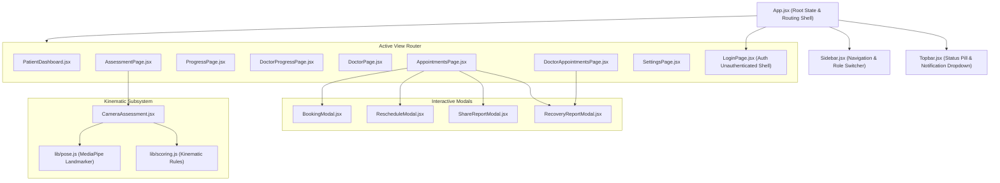

# Frontend Architecture

## 1. Overview and Component Tree

The frontend of **NeuroGuard AI** is built with **React 19** and bundled with **Vite 6**. It operates as a Single Page Application (SPA) designed for fast page transitions, low memory overhead, and native 60fps computer vision processing.



---

## 2. Directory Structure and Responsibilities

The frontend codebase is located under `frontend/` and structured as follows:

```
frontend/
├── public/
│   ├── mediapipe/wasm/             # Local WASM binaries & glue scripts
│   └── models/                     # pose_landmarker_lite.task (TFLite binary)
├── src/
│   ├── components/                 # Reusable UI & Modal components
│   │   ├── AlertCard.jsx           # Anomaly alert display with action buttons
│   │   ├── BookingModal.jsx        # In-person clinic slot reservation modal
│   │   ├── CameraAssessment.jsx    # Real-time MediaPipe video & canvas loop
│   │   ├── Logo.jsx                # SVG NeuroGuard brand badge
│   │   ├── MetricCard.jsx          # Individual domain score card (Movement, Balance)
│   │   ├── RecoveryReportModal.jsx # Comprehensive clinical report viewer
│   │   ├── RescheduleModal.jsx     # Atomic appointment rescheduling dialog
│   │   ├── ScoreRing.jsx           # Circular SVG recovery score gauge
│   │   ├── ShareReportModal.jsx    # Patient consent & doctor sharing authorization
│   │   ├── Sidebar.jsx             # Role-aware navigation sidebar
│   │   ├── Topbar.jsx              # System persistence status & notification center
│   │   └── TrendChart.jsx          # Longitudinal Recharts SVG line visualization
│   ├── lib/
│   │   ├── api.js                  # Centralized fetch client with JWT management
│   │   ├── demoData.js             # Presentation fallbacks and initial state
│   │   ├── pose.js                 # MediaPipe Tasks Vision loader & canvas drawing
│   │   └── scoring.js              # Joint kinematics, rep state machines, scoring
│   ├── pages/                      # Role-specific page views
│   │   ├── AppointmentsPage.jsx    # Patient doctor discovery & booking tabs
│   │   ├── AssessmentPage.jsx      # Exercise selector & live camera execution
│   │   ├── DoctorAppointmentsPage.jsx # Doctor schedule, slot blocking & confirm
│   │   ├── DoctorPage.jsx          # Clinician patient triage & exercise assigner
│   │   ├── DoctorProgressPage.jsx  # Multi-patient longitudinal review
│   │   ├── LoginPage.jsx           # Sign-in & registration with role toggles
│   │   ├── PatientDashboard.jsx    # Patient recovery overview & assigned care plan
│   │   ├── ProgressPage.jsx        # Patient historical recovery trends
│   │   └── SettingsPage.jsx        # Privacy controls and medical disclaimer
│   ├── styles/
│   │   └── app.css                 # Global CSS rules, layout tokens, and themes
│   ├── App.jsx                     # Top-level state coordinator & view switcher
│   └── main.jsx                    # React 19 root mount
├── package.json
└── vite.config.js
```

---

## 3. State Management & Lifecycle

Rather than introducing heavy third-party state managers like Redux or Zustand for a prototype, state is managed through a pragmatic combination of React functional hooks and web storage:

1. **Authentication Session State:** Stored in `sessionStorage` under `neuroguard.user` (JSON serialized user object) and `neuroguard.token` (raw JWT). Initialized lazily via `useState(() => loadSession())` in [App.jsx](https://github.com/Raj-shukla-05/NeuroGuard/blob/main/frontend/src/App.jsx#L21-L28).
2. **Global View Routing:** Controlled by `view` (`'dashboard'`, `'assessment'`, `'progress'`, `'doctor'`, `'appointments'`, `'settings'`). When a user logs in, `homeView(role)` routes doctors to `'doctor'` and patients to `'dashboard'`.
3. **Session Expiration Event Dispatcher:** If any authenticated fetch request receives an HTTP 401 Unauthorized, [api.js](https://github.com/Raj-shukla-05/NeuroGuard/blob/main/frontend/src/lib/api.js#L42-L45) dispatches a custom window event:
   ```javascript
   window.dispatchEvent(new CustomEvent('neuroguard:unauthorized'));
   ```
   [App.jsx](https://github.com/Raj-shukla-05/NeuroGuard/blob/main/frontend/src/App.jsx#L67-L74) listens for this event, gracefully clears the session, redirects the user to the login view, and displays an informative toast notification.

---

## 4. API Client Integration Architecture

All HTTP communications are encapsulated within the `api` singleton in [frontend/src/lib/api.js](https://github.com/Raj-shukla-05/NeuroGuard/blob/main/frontend/src/lib/api.js).

```javascript
// Generic request wrapper with automatic Bearer token injection
async function request(path, options = {}) {
  const headers = {
    'Content-Type': 'application/json',
    ...(options.headers || {}),
  };

  if (authToken) {
    headers['Authorization'] = `Bearer ${authToken}`;
  }

  const response = await fetch(`${API_BASE}${path}`, { ...options, headers });
  if (!response.ok) {
    const body = await response.json().catch(() => null);
    const error = new Error(body?.message || `Request failed: ${response.status}`);
    error.status = response.status;
    if (response.status === 401 && typeof window !== 'undefined') {
      window.dispatchEvent(new CustomEvent('neuroguard:unauthorized'));
    }
    throw error;
  }
  return response.json();
}
```

This client provides 30+ typed service methods spanning authentication, patient dashboards, appointments, report sharing, doctor management, and notifications.

---

## 5. Styling and Design System

The application uses modern Vanilla CSS (`app.css`) structured around healthcare-specific design tokens:

- **Colors:**
  - Teal Primary: `#0f766e` / `#14b8a6` (evoking clinical cleanliness and trust)
  - Dark Surface / Slate: `#0a0f1d` / `#131b2e` / `#1e293b`
  - Positive Recovery: `#10b981` (Emerald green for improving trends)
  - Clinical Monitor: `#f59e0b` (Amber for slight deviations)
  - Review Recommended: `#ef4444` (Crimson for persistent decline)
  - Medical Protocol Accent: `#3b82f6` (Royal blue for doctor-prescribed tasks)
- **Typography:** System font stack (`system-ui, -apple-system, BlinkMacSystemFont, 'Segoe UI', Roboto, sans-serif`) optimized for legibility and accessible contrast ratios.
- **Responsiveness:** Fluid grid layouts with media queries at `1024px`, `768px`, and `480px` providing adaptive sidebar collapsing and stacked scorecard cards on mobile devices.
