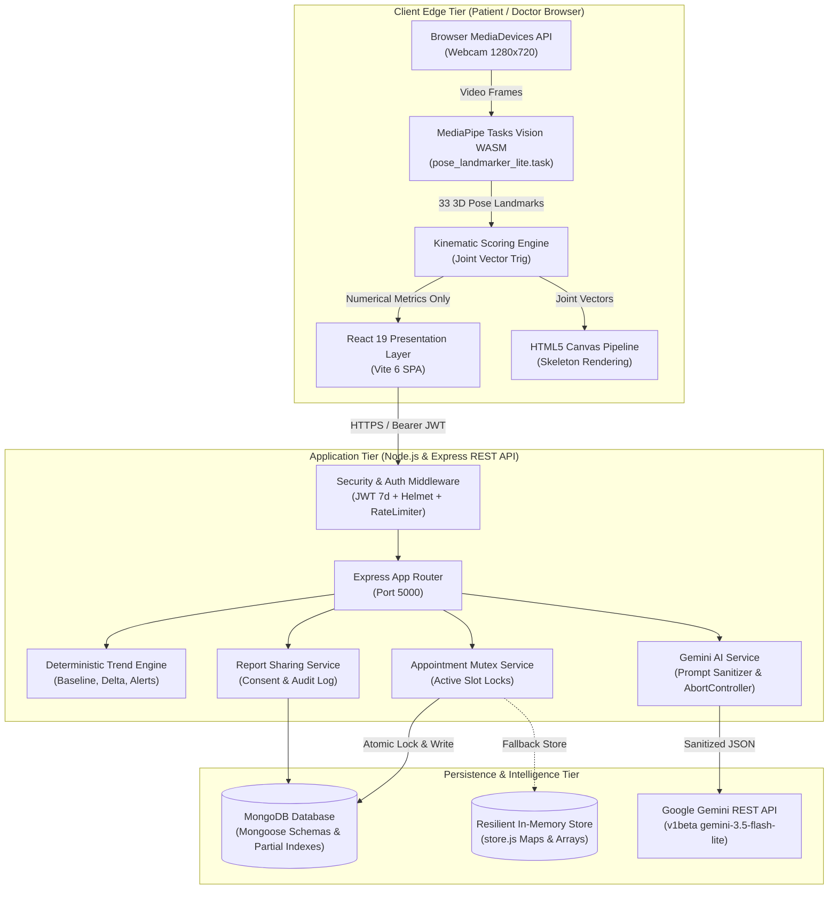

# System Architecture

## 1. High-Level Architectural Topology

NeuroGuard AI is designed as a privacy-centric, distributed web platform consisting of three primary tiers:

1. **Client Edge Execution Tier (Browser):** Handles video streaming, on-device MediaPipe pose tracking, frame extraction, joint angle mathematics, Recharts SVG rendering, and user interactions.
2. **Application & Orchestration Tier (Node.js/Express):** Handles authentication, role enforcement, appointment scheduling, moving-window baseline calculations, rate limiting, and prompt-sanitized AI orchestration.
3. **Persistence & Intelligence Tier:** A hybrid data layer featuring MongoDB Mongoose models with an automatic in-memory fallback store, paired with the Google Gemini API for natural-language explanations.



---

## 2. Layered Component Architecture

### A. Presentation & Client Execution Layer (Frontend)
- **Framework & Reactivity:** Built with React 19 functional components, hooks (`useState`, `useEffect`, `useRef`, `useMemo`), and Vite 6.
- **Client Routing Architecture:** Uses a stateful single-page view router orchestrated by `view` in [App.jsx](https://github.com/Raj-shukla-05/NeuroGuard-AI/blob/main/frontend/src/App.jsx). Views are conditionally rendered (`dashboard`, `assessment`, `progress`, `doctor`, `appointments`, `settings`) without requiring full page reloads.
- **Session State:** Session tokens and user profiles are held in `sessionStorage` (`neuroguard.user` and `neuroguard.token`), preventing cross-tab pollution and ensuring credentials clear when the browser window closes.

### B. Kinematic Computer Vision Engine
- **Local WASM Delivery:** The MediaPipe runtime (`vision_wasm_internal.wasm`, `vision_wasm_internal.js`, and SIMD variants) is hosted directly in `frontend/public/mediapipe/wasm/`. This eliminates external CDN dependencies, ensures offline capability, and guarantees predictable latency.
- **Dual Delegate Strategy:** Automatically detects WebGL support in [pose.js](https://github.com/Raj-shukla-05/NeuroGuard-AI/blob/main/frontend/src/lib/pose.js#L18-L47). It initializes the GPU delegate first for 60fps tracking; if WebGL fails or context is lost, it smoothly falls back to CPU execution.
- **Data Minimization Gateway:** The camera stream connects exclusively to an unmounted HTML `<video>` element. MediaPipe outputs coordinate points $(x, y, z, \text{visibility})$. The video element is never serialized, recorded, or sent to any server.

### C. Application Middleware & Gateways
- **Header Hardening:** Configured in [server.js](https://github.com/Raj-shukla-05/NeuroGuard-AI/blob/main/backend/src/server.js#L28-L33) using `helmet` with custom cross-origin resource policies and disabled CSP for WASM binary execution.
- **JWT Authentication:** Cryptographically validates tokens using `jsonwebtoken` with 7-day lifespans and extracts `{ userId, role, name, email }` into `req.user`.
- **Role-Based Authorization:** `requireRole('patient', 'doctor')` and `requireSelfOrDoctor` protect endpoints from vertical and horizontal privilege escalation (IDOR).
- **Rate Limiting:** Sliding-window rate limiters in [rateLimiter.js](https://github.com/Raj-shukla-05/NeuroGuard-AI/blob/main/backend/src/middleware/rateLimiter.js) protect sensitive endpoints (e.g., appointment booking is capped at 15 requests per minute per IP/user).

### D. Core Business & Domain Services
- **Longitudinal Trend Engine ([trendEngine.js](https://github.com/Raj-shukla-05/NeuroGuard-AI/blob/main/backend/src/trendEngine.js)):** Calculates personal baselines, computes percentage deltas, classifies recovery bands, and triggers alerts for 3-session persistent decline.
- **Appointment & Schedule Service ([appointmentService.js](https://github.com/Raj-shukla-05/NeuroGuard-AI/blob/main/backend/src/services/appointmentService.js)):** Generates discrete clinic slots, manages mutex lock keys (`activeBookingLocks`), and enforces state machine transitions.
- **Report Compilation & Sharing Service ([reportSharingService.js](https://github.com/Raj-shukla-05/NeuroGuard-AI/blob/main/backend/src/services/reportSharingService.js)):** Aggregates genuine historical assessment records, generates clinical previews, verifies explicit patient consent, and maintains an immutable access audit trail.
- **AI Explanation Service ([geminiService.js](https://github.com/Raj-shukla-05/NeuroGuard-AI/blob/main/backend/src/services/geminiService.js)):** Orchestrates prompts to Gemini, enforces timeout aborts, and provides an offline local explanation fallback.

---

## 3. Communication Protocols and Formats

| Flow | Protocol | Format | Security / Auth |
| :--- | :--- | :--- | :--- |
| **Client $\leftrightarrow$ Server API** | HTTP/1.1 or HTTP/2 | JSON (`application/json`) | Authorization: Bearer `<JWT>` |
| **Client $\leftrightarrow$ Camera Hardware** | WebRTC MediaStream API | YUV/RGB Frame Buffer | Browser Permission Dialog |
| **Server $\leftrightarrow$ MongoDB** | MongoDB Wire Protocol | BSON | TLS / Connection String (`MONGODB_URI`) |
| **Server $\leftrightarrow$ Gemini API** | HTTPS POST | JSON | Header: `x-goog-api-key: <KEY>` |
| **Client Notifications** | HTTP Polling (15s interval) | JSON | Authenticated Bearer JWT |

---

## 4. Architectural Resilience and High-Availability Design

```
+-------------------------------------------------------------------------------+
|                       RESILIENCE DECISION TREE                                |
+-------------------------------------------------------------------------------+
| Check MongoDB Connection:                                                     |
|   ├── Connected? ======> Read/Write MongoDB (Permanent Disk Persistence)      |
|   └── Offline?   ======> Fallback to In-Memory Store (Resilient Session Mode) |
|                                                                               |
| Check Gemini API Key & Network:                                               |
|   ├── Available? ======> Stream Gemini LLM Summary (source: 'gemini')          |
|   └── Failed/NoKey? ===> Use Local Deterministic Engine (source: 'local')     |
|                                                                               |
| Check Client GPU Acceleration:                                                |
|   ├── WebGL Available? => Use GPU Delegate (Hardware Accelerated 60 FPS)      |
|   └── WebGL Failed?   => Fallback to CPU Delegate (Software Emulated 30 FPS)  |
+-------------------------------------------------------------------------------+
```

The system is architected for **zero catastrophic failure points**. If external databases, cloud AI APIs, or hardware accelerators become unavailable, the platform automatically degrades gracefully:
1. If MongoDB is down, the server operates seamlessly in in-memory mode.
2. If the Gemini API is unreachable, local rule-based explanations are returned.
3. If GPU acceleration fails, MediaPipe executes smoothly on the CPU.
