# Known Security Limitations & Production Hardening Roadmap

While NeuroGuard AI implements defense-in-depth protections suitable for a functional prototype, several known architectural limitations exist that must be hardened prior to clinical trial deployment or commercial healthcare launch.

---

## 1. Known Architectural Security Limitations

### 1. Long-Lived JWT Tokens Without Refresh Rotation
- **Current State:** JWTs are issued with a fixed 7-day expiration (`expiresIn: '7d'`). There is no refresh token rotation mechanism, nor is there a server-side token revocation blacklist.
- **Risk:** If a JWT is intercepted from client `sessionStorage` (e.g. via an XSS vulnerability), the attacker can query protected endpoints until the 7-day token expires.
- **Hardening Plan:** Implement short-lived access tokens (15 minutes) paired with HTTP-only, secure, SameSite refresh tokens stored in Redis with automatic rotation on refresh.

### 2. Client-Side Session Storage vs HTTP-Only Cookies
- **Current State:** Tokens are stored in `window.sessionStorage`.
- **Risk:** While safer than `localStorage` because it clears upon tab closure, `sessionStorage` remains accessible to client-side JavaScript executing in the same origin.
- **Hardening Plan:** Migrate authentication tokens to `Set-Cookie` headers with `HttpOnly`, `Secure`, and `SameSite=Strict` flags.

### 3. Open Doctor Role Registration
- **Current State:** Any user can register an account with `role: 'doctor'` on the signup screen.
- **Risk:** Non-medical users could create fake doctor profiles that appear in the public clinic directory.
- **Hardening Plan:** Restrict doctor signup to an administrative approval pipeline requiring medical registration number verification (e.g., National Medical Commission / General Medical Council API verification) and clinical credential review before profile activation.

### 4. In-Memory Sliding-Window Rate Limiter
- **Current State:** [rateLimiter.js](https://github.com/Raj-shukla-05/NeuroGuard-AI/blob/main/backend/src/middleware/rateLimiter.js) manages request counters in an in-memory `Map`.
- **Risk:** If the Express backend is scaled horizontally across multiple instances or serverless containers, rate limiting counts are not synchronized across nodes.
- **Hardening Plan:** Migrate rate limiting to an external distributed cache such as Redis (`ioredis` + `express-rate-limit-redis`).

### 5. Content Security Policy (CSP) Disabling
- **Current State:** In [server.js](https://github.com/Raj-shukla-05/NeuroGuard-AI/blob/main/backend/src/server.js#L30), Helmet's `contentSecurityPolicy` is disabled (`contentSecurityPolicy: false`) to allow Vite and MediaPipe WebAssembly to execute without restrictive script-src evaluation blocking.
- **Risk:** Leaves the application vulnerable to malicious script injections if an XSS vector is introduced.
- **Hardening Plan:** Define a strict CSP policy explicitly whitelisting `'wasm-unsafe-eval'`, `'self'`, and trusted Google Gemini endpoints.

---

## 2. Production Security Hardening Roadmap

```mermaid
flowchart LR
    subgraph M1 ["Milestone 1: Immediate Hardening"]
        direction TB
        M1A["Short-Lived JWTs (15 min) + Refresh Cookies"]
        M1B["Strict CSP Headers Whitelisting WASM"]
        M1C["Redis-Backed Distributed Rate Limiter"]
    end

    subgraph M2 ["Milestone 2: Pre-Clinical Controls"]
        direction TB
        M2A["Doctor License Verification Workflow"]
        M2B["End-to-End Audit Log Encryption (AES-256)"]
        M2C["Mandatory Multi-Factor Authentication (MFA)"]
    end

    subgraph M3 ["Milestone 3: Enterprise Compliance"]
        direction TB
        M3A["SOC 2 Type II Certification"]
        M3B["HIPAA / HITECH External Compliance Audit"]
        M3C["Automated Penetration Testing & Bug Bounty"]
    end

    M1 --> M2 --> M3
```

