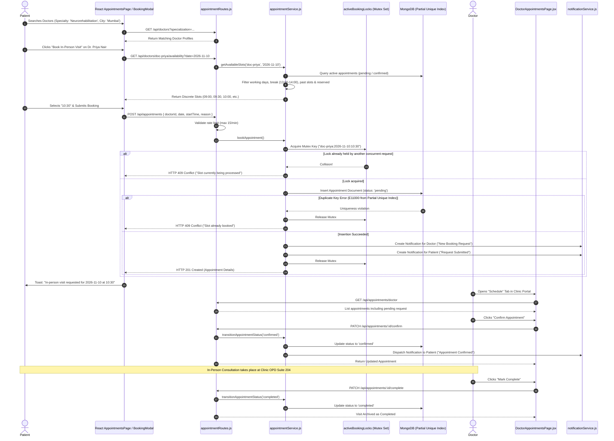

# End-to-End Workflow: In-Person Appointment Discovery, Mutex Booking & Confirmation

This document traces the complete lifecycle of an in-person clinical consultation—from doctor discovery and availability slot generation to atomic mutex booking, double-booking prevention, doctor confirmation, and clinical visit completion.

---

## 1. Complete Appointment Lifecycle Sequence Diagram



---

## 2. Step-by-Step Technical Execution

### Step 1: Doctor Discovery & Availability Exploration
- **Frontend Action:** Patient selects filters in [AppointmentsPage.jsx](https://github.com/Raj-shukla-05/NeuroGuard/blob/main/frontend/src/pages/AppointmentsPage.jsx).
- **API Call:** `GET /api/doctors` with query filters `search`, `specialization`, and `city`.
- **Backend Handler:** [doctorRoutes.js](https://github.com/Raj-shukla-05/NeuroGuard/blob/main/backend/src/routes/doctorRoutes.js#L11-L81) searches both in-memory and MongoDB doctor records.

### Step 2: Slot Generation with Break & Block Exclusion
- **Frontend Action:** Patient opens [BookingModal.jsx](https://github.com/Raj-shukla-05/NeuroGuard/blob/main/frontend/src/components/BookingModal.jsx) and selects a date.
- **API Call:** `GET /api/doctors/:id/availability?date=YYYY-MM-DD`.
- **Backend Processing:** In [appointmentService.js](https://github.com/Raj-shukla-05/NeuroGuard/blob/main/backend/src/services/appointmentService.js#L97-L249):
  1. Checks if the date is a working day (`availability.workingDays.includes(dayOfWeek)`).
  2. Checks if the date is in `unavailableDates`.
  3. Iterates in 30-minute increments from 09:00 to 17:00.
  4. Marks lunch break (13:00–14:00) with `available: false` and `unavailableReason: 'Clinic Break'`.
  5. Marks doctor-blocked slots with `available: false` and the doctor's custom reason.
  6. Marks past times today as `available: false`.
  7. Checks existing active bookings in MongoDB/store.js; any reserved slot is marked `available: false`.

### Step 3: Atomic Booking & Race-Condition Defense
- **Rate Limiting:** In [appointmentRoutes.js](https://github.com/Raj-shukla-05/NeuroGuard/blob/main/backend/src/routes/appointmentRoutes.js#L23), `bookingRateLimiter` ensures requests do not exceed 15 per minute per IP.
- **Mutex Acquisition:** In [appointmentService.js](https://github.com/Raj-shukla-05/NeuroGuard/blob/main/backend/src/services/appointmentService.js#L292-L302), a mutex string `${doctor.id}:${date}:${startTime}` is registered in `activeBookingLocks`.
- **Database Insertion:** Inserts the appointment document. MongoDB evaluates the partial unique index:
  ```javascript
  AppointmentSchema.index({ doctorId: 1, date: 1, startTime: 1 }, { unique: true, partialFilterExpression: { status: { $in: ['pending', 'confirmed'] } } });
  ```
  If another process inserted the identical slot, MongoDB throws a duplicate key error (`code: 11000`), caught and translated to HTTP 409 Conflict.
- **Mutex Release:** In the `finally` block, `activeBookingLocks.delete(lockKey)` releases the lock.

### Step 4: Notification Dispatch
- The service calls `createNotification()`:
  - Doctor receives a `booking_created` alert: *"Raj Kumar has booked an in-person clinical visit on 2026-11-10 at 10:30."*
  - Patient receives a confirmation alert: *"Your in-person visit with Dr. Priya Nair... has been submitted."*

### Step 5: Doctor Confirmation & Lifecycle Transitions
- **Confirmation:** The attending doctor reviews their schedule on [DoctorAppointmentsPage.jsx](https://github.com/Raj-shukla-05/NeuroGuard/blob/main/frontend/src/pages/DoctorAppointmentsPage.jsx) and clicks *"Confirm"*. `PATCH /api/appointments/:id/confirm` transitions status from `'pending'` to `'confirmed'` and notifies the patient.
- **Completion:** Following the physical clinic encounter, the doctor clicks *"Mark Complete"*. Status transitions to `'completed'`.
- **Cancellation / Rescheduling:** If the visit cannot take place, the patient or doctor can cancel or atomically reschedule using [RescheduleModal.jsx](https://github.com/Raj-shukla-05/NeuroGuard/blob/main/frontend/src/components/RescheduleModal.jsx).
