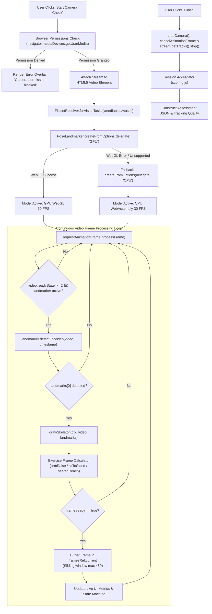

# End-to-End Workflow: Camera Permission, MediaPipe Initialization & Pose Tracking

This document traces the technical execution pipeline for browser camera initialization, MediaPipe WebAssembly compilation, hardware delegate selection, continuous frame evaluation, and anatomical landmark extraction.

---

## 1. Technical Execution Pipeline



---

## 2. Deep Technical Breakdown

### Step 1: Camera Permission Acquisition
- **Method:** `navigator.mediaDevices.getUserMedia({ video: { width: { ideal: 1280 }, height: { ideal: 720 }, facingMode: 'user' }, audio: false })`.
- **Error Handling:** If the user denies permission, the promise rejects with a `NotAllowedError`. [CameraAssessment.jsx](file:///home/piyush/Team Matrix/Hacksprint/frontend/src/components/CameraAssessment.jsx#L63-L67) catches this error and displays an error message with a *"Try again"* button.

### Step 2: MediaPipe WebAssembly Loading
- **FilesetResolver:** In [pose.js](file:///home/piyush/Team Matrix/Hacksprint/frontend/src/lib/pose.js#L12), `FilesetResolver.forVisionTasks('/mediapipe/wasm')` fetches the local binary files (`vision_wasm_internal.wasm` and JS glue code).
- **Network Resilience:** Loading locally from `/mediapipe/wasm` ensures zero CDN dependencies, consistent MIME types, and offline availability.

### Step 3: Hardware Delegate Negotiation (GPU $\rightarrow$ CPU Fallback)
- **First Attempt (GPU):**
  ```javascript
  return await PoseLandmarker.createFromOptions(vision, {
    baseOptions: { modelAssetPath: '/models/pose_landmarker_lite.task', delegate: 'GPU' },
    runningMode: 'VIDEO',
    numPoses: 1,
    minPoseDetectionConfidence: 0.55,
    minPosePresenceConfidence: 0.55,
    minTrackingConfidence: 0.55,
  });
  ```
- **Fallback (CPU):** If WebGL compilation fails (e.g. older integrated GPU or Linux driver mismatch), the catch block re-invokes `createFromOptions` with `delegate: 'CPU'`.

### Step 4: Video Frame Pipeline & Timestamp Synchronization
- In `processFrame(timestamp)`, the video element's natural width/height are applied to the overlay canvas (`canvas.width = video.videoWidth || 1280`).
- `landmarker.detectForVideo(video, timestamp)` processes the current video frame using the `DOMHighResTimeStamp` provided by `requestAnimationFrame`. This allows MediaPipe's internal temporal tracking and landmark smoothing filters to run accurately.

### Step 5: Skeletal Canvas Overlay Rendering
- In [pose.js](file:///home/piyush/Team Matrix/Hacksprint/frontend/src/lib/pose.js#L106-L140), `drawSkeleton(ctx, video, landmarks)` clears the previous canvas frame and renders:
  - 14 anatomical connections with an aqua stroke (`#8fe3d5`, line width 4).
  - 12 joint circles with teal fill (`#0f766e`, radius 5.5px) for every landmark whose `visibility >= 0.4`.

### Step 6: Kinematic State Machine & Buffer Management
- The frame is evaluated by the selected exercise calculator (`armRaiseFrame`, `sitToStandFrame`, or `seatedReachFrame`).
- If required anatomical joints are visible (`frame.ready === true`), the frame object is appended to `framesRef.current`.
- To prevent unbounded memory consumption during extended sessions, `framesRef.current` is capped at 450 frames using a sliding-window discard (`if (frames.length > 450) frames.shift()`).
- Live metrics (repetition counts, current angle, and movement phase) are dispatched to the React UI.

### Step 7: Camera Resource Teardown
- When the patient finishes the assessment or navigates away, `stopCamera()` is executed:
  1. `cancelAnimationFrame(rafRef.current)`.
  2. `streamRef.current.getTracks().forEach(track => track.stop())` turns off the hardware webcam indicator LED.
  3. Canvas context is cleared and internal buffers are released.
