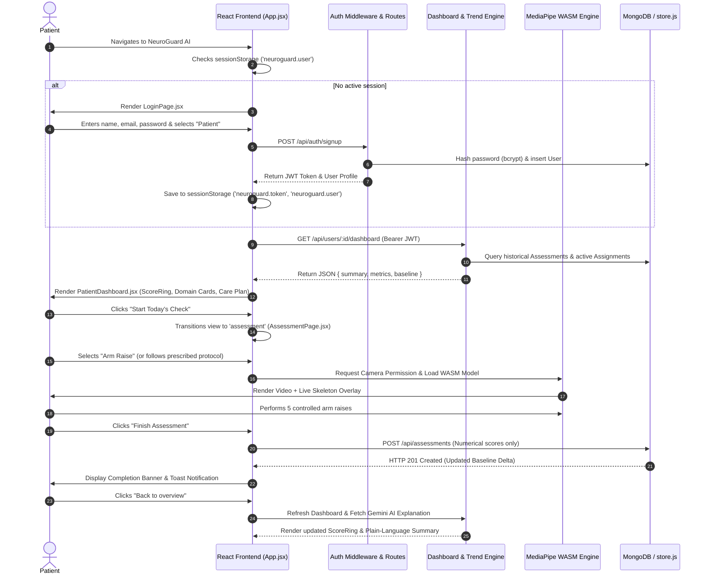

# End-to-End Workflow: Patient Registration, Daily Check-In & Dashboard

This document details the complete end-to-end user and technical workflow for a stroke survivor using NeuroGuard AI—from initial registration through daily functional check-in and dashboard inspection.

---

## 1. Complete Workflow Sequence Diagram

---

## 2. Step-by-Step Technical Execution

### Step 1: Authentication & Session Initialization
- **User Action:** Patient enters credentials or clicks demo login.
- **Frontend Component:** [LoginPage.jsx](file:///home/piyush/Team Matrix/Hacksprint/frontend/src/pages/LoginPage.jsx).
- **API Request:** `POST /api/auth/login` with `{ email, password }`.
- **Backend Handler:** [server.js](file:///home/piyush/Team Matrix/Hacksprint/backend/src/server.js#L66-L100).
- **Backend Function:** `bcrypt.compare()` verifies the password hash, and `generateToken()` issues a 7-day JWT.
- **Client Storage:** `api.setAuthToken(token)` stores the JWT in `sessionStorage.getItem('neuroguard.token')`.

### Step 2: Dashboard Data Retrieval
- **Frontend Component:** [PatientDashboard.jsx](file:///home/piyush/Team Matrix/Hacksprint/frontend/src/pages/PatientDashboard.jsx).
- **API Request:** `GET /api/users/:id/dashboard`.
- **Backend Processing:** [trendEngine.js](file:///home/piyush/Team Matrix/Hacksprint/backend/src/trendEngine.js#L51-L92) compiles the last 5 sessions into an arithmetic baseline and calculates the relative percentage change.
- **Rendering:** [ScoreRing.jsx](file:///home/piyush/Team Matrix/Hacksprint/frontend/src/components/ScoreRing.jsx) renders the circular gauge, while [MetricCard.jsx](file:///home/piyush/Team Matrix/Hacksprint/frontend/src/components/MetricCard.jsx) renders domain cards for Movement, Balance, Coordination, and Speech.

### Step 3: Clinician Protocol Identification
- **Frontend Processing:** Queries `GET /api/patients/:id/assignments`.
- **Display:** If an active assignment exists, an amber/blue card displays the doctor's specific guidance (e.g., *"Perform 5 slow arm raises; hold 1s at peak"*).
- **Action:** Clicking *"Start Assigned Protocol"* binds `selectedAssignment`, automatically pre-selecting the prescribed exercise in the assessment view.

### Step 4: Camera Check & Kinetic Assessment
- **Frontend Component:** [CameraAssessment.jsx](file:///home/piyush/Team Matrix/Hacksprint/frontend/src/components/CameraAssessment.jsx).
- **Browser Permission:** `navigator.mediaDevices.getUserMedia({ video: true, audio: false })`.
- **Engine Initialization:** MediaPipe FilesetResolver loads `/mediapipe/wasm` and builds `PoseLandmarker` from `/models/pose_landmarker_lite.task`.
- **Execution Loop:** `requestAnimationFrame` continuously executes `detectForVideo()` and `drawSkeleton()`.

### Step 5: Session Submission & Persistence
- **Client Validation:** [AssessmentPage.jsx](file:///home/piyush/Team Matrix/Hacksprint/frontend/src/pages/AssessmentPage.jsx#L26-L37) verifies `score > 0` and `duration >= 3`.
- **API Request:** `POST /api/assessments` sending metrics `{ score, duration, metrics, assignmentId, trackingQuality }`.
- **Backend Verification:** [server.js](file:///home/piyush/Team Matrix/Hacksprint/backend/src/server.js#L540-L545) verifies `validFrames >= 5`.
- **Database Persistence:** Inserts document into MongoDB `Assessment` collection (or `store.js`). If `assignmentId` is present, it transitions the assignment status to `completed`.

### Step 6: Post-Session AI Summary
- **API Request:** `POST /api/explanation` with `{ findings }`.
- **Backend Processing:** `sanitizeFindings()` cleans unmeasured metrics and queries Gemini API (with local fallback).
- **User Display:** The dashboard updates with the new baseline delta and displays an empathetic AI explanation.
