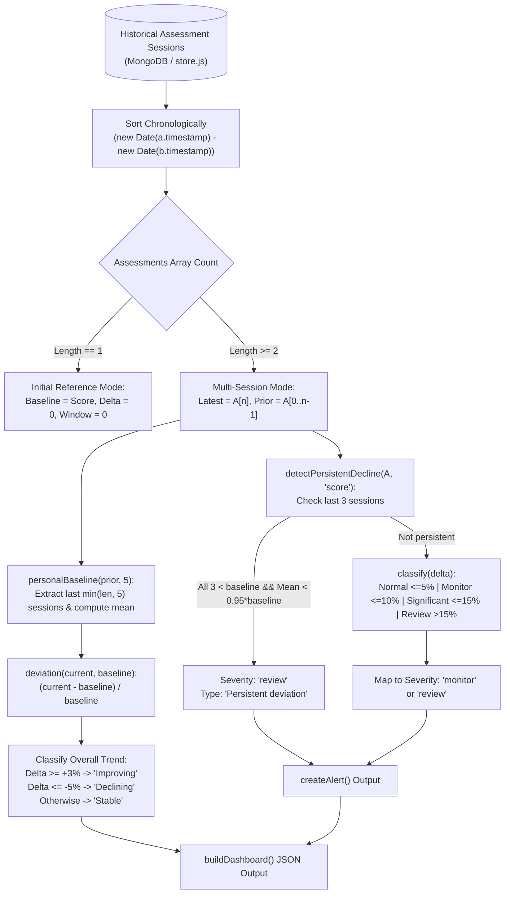

# End-to-End Workflow: Assessment History, Baseline Calculation & Trend Engine

This document details the complete mathematical and computational workflow through which historical assessment records are processed into dynamic personal baselines, deviation percentages, trend classifications, and clinical anomaly alerts.

---

## 1. Longitudinal Calculation Pipeline



---

## 2. Step-by-Step Computational Workflow

### Step 1: Historical Ingestion & Chronological Sorting
When `buildDashboard(user, assessments)` is called in [trendEngine.js](file:///home/piyush/Team Matrix/Hacksprint/backend/src/trendEngine.js#L51-L92):
- The array is shallow-copied and sorted:
  ```javascript
  const ordered = assessments.slice().sort((a, b) => new Date(a.timestamp) - new Date(b.timestamp));
  ```
- The most recent session is extracted as `latest = ordered[ordered.length - 1]`.
- All earlier sessions are isolated as `prior = ordered.slice(0, -1)`.

### Step 2: Personal Baseline Derivation
- If `prior.length === 0`, this is the user's first check-in:
  - `baseline = latest.score`
  - `change = 0`
  - `window = 0`
- If `prior.length > 0`:
  - `personalBaseline(prior, 'score', 5)` slices the last 5 records of `prior`:
    ```javascript
    function personalBaseline(assessments, field = 'score', windowSize = 5) {
      const values = assessments
        .slice(-windowSize)
        .map((a) => field === 'score' ? Number(a.score) : Number(a.metrics?.[field] ?? 0))
        .filter(Number.isFinite);
      return mean(values);
    }
    ```

### Step 3: Relative Percentage Delta Calculation
- Computes fractional change relative to baseline:
  $$\delta = \frac{\text{Current Score} - \text{Baseline Score}}{\text{Baseline Score}}$$
- Clamped and rounded for display:
  $$\text{DisplayChange} = \frac{\text{Math.round}(\delta \times 1000)}{10}$$

### Step 4: Individual Domain Metric Processing
- The engine applies the identical moving-window baseline logic independently to each measured domain (`movement`, `balance`, `coordination`, `speech`).
- If a domain was **not collected** in the latest session, `raw === undefined || raw === null`, and the engine sets that metric to `null`.
- This ensures unmeasured dimensions are not erroneously assumed to be zero.

### Step 5: Persistent Decline Anomaly Detection
In [trendEngine.js](file:///home/piyush/Team Matrix/Hacksprint/backend/src/trendEngine.js#L42-L49), `detectPersistentDecline()` detects downward trends:
```javascript
function detectPersistentDecline(assessments, field = 'score') {
  if (assessments.length < 3) return false;
  const recent = assessments.slice(-3).map((a) => field === 'score' ? Number(a.score) : Number(a.metrics?.[field] ?? 0));
  const previous = assessments.slice(0, -3);
  if (!previous.length) return false;
  const baseline = personalBaseline(previous, field, 5);
  return recent.every((value) => value < baseline) && mean(recent) < baseline * 0.95;
}
```

### Step 6: Alert Generation & Severity Assignment
In [trendEngine.js](file:///home/piyush/Team Matrix/Hacksprint/backend/src/trendEngine.js#L94-L116), `createAlert()` assigns alert properties:
- If `detectPersistentDecline` is `true`:
  - `severity = 'review'`
  - `type = 'Persistent deviation'`
  - `action = 'Review recommended'`
  - Reason: *"Functional performance is X% below the recent baseline across the last three sessions."*
- If not persistent, the relative delta is evaluated by `classify(delta)`:
  - If `normal` ($\le 5\%$), returns `null` (no alert rendered, patient shown `<StableCard />`).
  - If `monitor` ($5\text{--}10\%$), returns an amber alert with `action = 'Review change'`.
  - If `significant` ($10\text{--}15\%$) or `review` ($> 15\%$), returns an amber/red alert.

### Step 7: Dashboard Assembly & UI Propagation
- The compiled object `{ user, summary, metrics, baseline }` is returned to [PatientDashboard.jsx](file:///home/piyush/Team Matrix/Hacksprint/frontend/src/pages/PatientDashboard.jsx).
- The dashboard renders:
  1. Primary ScoreRing with baseline delta.
  2. Four domain MetricCards with individual relative changes.
  3. Recharts SVG trend chart spanning Day 1 to the current date.
  4. Active alert cards or stable state badge.
