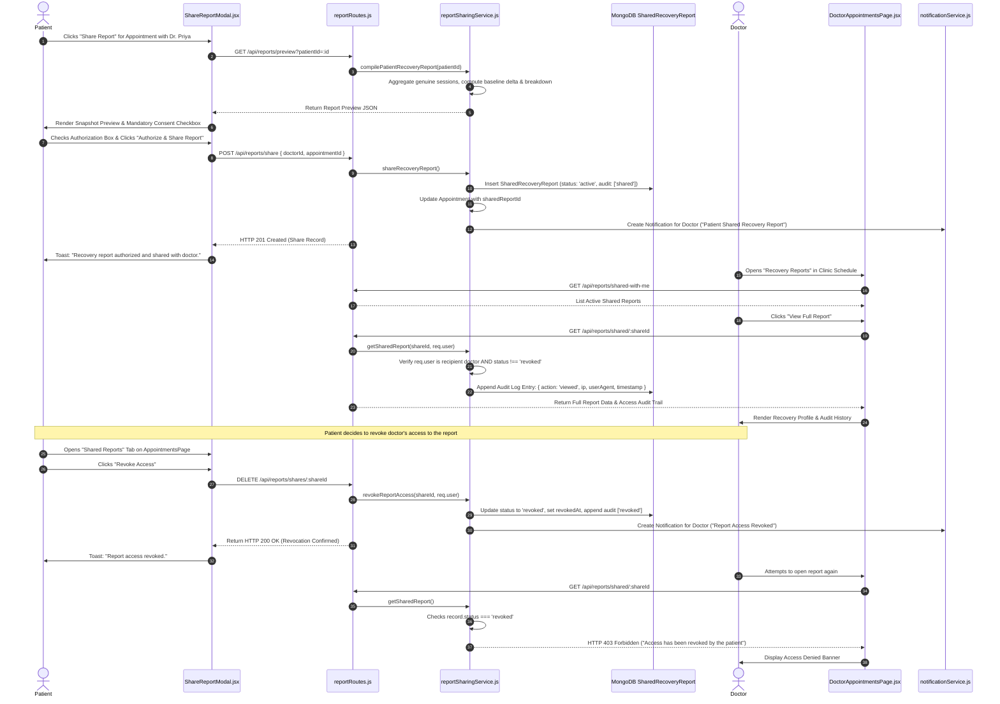

# End-to-End Workflow: Clinical Recovery Report Sharing, Consent & Revocation

This document traces the complete workflow for compiling an objective patient recovery report, obtaining explicit informed consent, securely sharing the report with an attending clinician, logging audit events, and handling immediate access revocation.

---

## 1. Complete Report Sharing & Revocation Sequence Diagram



---

## 2. Step-by-Step Technical Execution

### Step 1: Report Preview Compilation
- **Frontend Action:** Patient clicks *"Share Report"* on an appointment card in [AppointmentsPage.jsx](https://github.com/Raj-shukla-05/NeuroGuard-AI/blob/main/frontend/src/pages/AppointmentsPage.jsx).
- **API Request:** `GET /api/reports/preview?patientId=:id`.
- **Backend Function:** In [reportSharingService.js](https://github.com/Raj-shukla-05/NeuroGuard-AI/blob/main/backend/src/services/reportSharingService.js#L14-L95), `compilePatientRecoveryReport()`:
  - Gathers real assessment records for the patient from MongoDB and the active session store.
  - Sorts sessions descending by timestamp (`recentSessions = patientAssessments.slice(0, 10)`).
  - Computes personal baseline score: `personalBaseline(scores)`.
  - Calculates longitudinal trend data via `buildTrend()`.
  - Groups assessments by protocol: `arm_raise`, `sit_to_stand`, and `seated_reach`.
  - Attaches the clinical non-diagnostic disclaimer.

### Step 2: Informed Patient Consent Verification
- **Frontend Interface:** [ShareReportModal.jsx](https://github.com/Raj-shukla-05/NeuroGuard-AI/blob/main/frontend/src/components/ShareReportModal.jsx#L98-L115).
- **Mandatory Consent Checkbox:** The submit button remains disabled until the patient checks the authorization checkbox:
  ```html
  <input type="checkbox" id="report-consent" checked={consentChecked} onChange={(e) => setConsentChecked(e.target.checked)} required />
  ```
- **Consent Text:** *"I explicitly authorize Dr. Priya Nair to view my NeuroGuard assessment history, movement scores, and baseline trends for in-person clinical review. I can revoke access at any time."*

### Step 3: Authorization Persistence & Linkage
- **API Request:** `POST /api/reports/share` with `{ doctorId, appointmentId, patientId }`.
- **Backend Processing:** In [reportSharingService.js](https://github.com/Raj-shukla-05/NeuroGuard-AI/blob/main/backend/src/services/reportSharingService.js#L142-L211):
  - Captures `clientIp` and `userAgent` from request headers.
  - Creates document in `SharedRecoveryReport` collection with `status: 'active'`.
  - Initializes `accessAuditLog` with action `'shared'`.
  - If `appointmentId` was provided, updates the `Appointment` document with `sharedReportId = shareId`.
  - Calls `createNotification()` to alert the doctor.

### Step 4: Doctor Access & Audit Logging
- **Doctor Action:** Doctor clicks *"View Full Report"* in [DoctorAppointmentsPage.jsx](https://github.com/Raj-shukla-05/NeuroGuard-AI/blob/main/frontend/src/pages/DoctorAppointmentsPage.jsx).
- **API Request:** `GET /api/reports/shared/:shareId`.
- **Authorization Check:** In [reportSharingService.js](https://github.com/Raj-shukla-05/NeuroGuard-AI/blob/main/backend/src/services/reportSharingService.js#L241-L250), verifies caller is the designated doctor recipient.
- **Revocation Check:** Verifies `record.status !== 'revoked'`.
- **Audit Logging:** Appends a new entry to `accessAuditLog`:
  ```javascript
  {
    doctorId: record.doctorId,
    doctorUserId: actingUser.userId,
    action: 'viewed',
    accessedAt: new Date().toISOString(),
    ip: clientIp,
    userAgent
  }
  ```
- **Modal Display:** [RecoveryReportModal.jsx](https://github.com/Raj-shukla-05/NeuroGuard-AI/blob/main/frontend/src/components/RecoveryReportModal.jsx) renders the full profile and displays the audit log history.

### Step 5: Patient Access Revocation
- **Patient Action:** In the *"Shared Reports"* tab, patient clicks *"Revoke Access"*.
- **Confirmation:** Browser displays confirmation prompt: *"Are you sure you want to revoke this doctor’s access to your recovery report?"*
- **API Request:** `DELETE /api/reports/shares/:shareId`.
- **Backend Processing:** In [reportSharingService.js](https://github.com/Raj-shukla-05/NeuroGuard-AI/blob/main/backend/src/services/reportSharingService.js#L315-L355):
  - Sets `record.status = 'revoked'`.
  - Sets `record.revokedAt = new Date().toISOString()`.
  - Appends audit entry: `{ action: 'revoked', ip, userAgent }`.
  - Dispatches notification to doctor: *"Raj Kumar has revoked access to their previously shared recovery report."*

### Step 6: Enforcement on Subsequent Attempts
- If the doctor attempts to open the report after revocation, `getSharedReport()` catches `record.status === 'revoked'` and immediately throws an HTTP 403 Forbidden error:
  ```json
  { "message": "Forbidden: Access to this recovery report has been revoked by the patient." }
  ```
